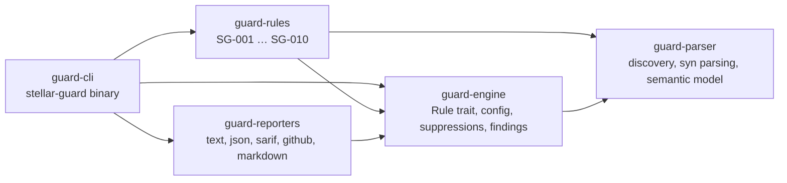
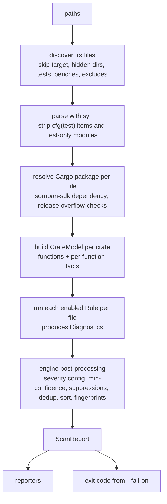

# Architecture

stellar-guard is a Cargo workspace of five crates with a strict one-way dependency graph:

## Pipeline

### guard-parser

* `discover` — walks each path (sorted, deterministic), skipping `target/`, `node_modules/`, hidden
  directories, and by default `tests/`, `benches/`, `test_snapshots/` and cargo-fuzz `fuzz_targets/`. User globs are matched
  relative to the scan root.
* `project` — reads and parses files with `syn` (`span-locations` gives line/column). Unless
  `include-tests` is set, items annotated `#[cfg(test)]` / `#[test]` are removed, and out-of-line
  modules declared under `#[cfg(test)] mod test;` are dropped. Files that fail to parse become
  `ParseFailure`s; the scan continues.
* `cargo` — finds each file's package (`Cargo.toml` with `[package]`), whether it depends on
  `soroban-sdk`, its local (`path` / `workspace = true`) dependencies, and `overflow-checks` from
  the workspace root manifest (`[profile.release]`, overridden per package).
* `syntax` — helpers: method-chain flattening, local `let` binding resolution, storage call
  recognition (`env.storage().<tier>().<op>(..)`, including through a stored handle), identifier
  word-splitting, macro argument parsing.
* `model` — a `CrateModel` per crate: every function (`ContractExport`, `Method`, `Free`, trait
  default methods) with its module path, plus `FnFacts` (auth checks and their subjects, whether
  they run on every path, storage reads/writes with tier, key and value, outflow transfers, WASM
  upgrades, event publications, init guards, call sites with their arguments). Functions of local dependency crates are
  included (marked `foreign`) so calls into a shared library crate resolve; each crate's facts are
  computed once per scan. Queries over helpers:
  * `witness()` — "does this export, or anything it calls, write storage?", returning the call site
    in the queried function so findings point at code the user can see;
  * `auth_status()` — whether authorization happens on every path, some paths, or never;
  * `subject_auth()` / `debits()` — which parameters are authorized and which parameter-keyed
    values are decreased, mapped through argument positions;
  * `written_keys()`, `init_guard_keys()`, `reachable()`.

  Traversals track the current call chain (not every function seen), so a helper called twice is
  analysed at both call sites, with a depth limit for very deep chains.

  Code layout: `model/mod.rs` (types, construction, call resolution), `model/items.rs` (functions
  and constants from parsed files), `model/facts.rs` (the per-function fact visitor),
  `model/queries.rs` (the queries above) and `model/graph.rs`. Every call site is resolved once when
  the model is built (`CrateModel::callees`), and `auth_status`, `subject_auth`, `debits` and
  `reachable` are cached per function, so rules asking the same question share the work.

### guard-engine

* `Rule` trait: `meta()` (static `RuleMeta`: id, name, summary, description, remediation,
  default severity, tags, options) and `check(&RuleContext, &mut Vec<Diagnostic>)`.
* `Diagnostic` carries a span, message, confidence, optional severity hint and function name.
* `Settings` = `stellar-guard.toml` merged with CLI flags. Unknown keys, unknown rule IDs and
  unknown rule options are rejected so typos never silently disable checks.
* Post-processing: effective severity is *user override → rule hint → rule default*; findings
  below `min-confidence` are dropped; inline suppressions are applied (and counted); findings are
  de-duplicated, sorted by location, and given stable fingerprints.
* Reports contain no timestamps or durations, so the same input always produces byte-identical
  output.

### guard-rules

One module per rule. Rules are pure functions of the parsed project and options, and each has unit
tests for true positives and false positives. See [rules/](rules/README.md).

### guard-reporters

Renders a `ScanReport`:

| Format | Use |
|---|---|
| `text` | terminal, compiler-style with source snippet and caret |
| `json` | machine-readable, versioned schema (see [report-format.md](report-format.md)) |
| `sarif` | SARIF 2.1.0 for GitHub code scanning and other SARIF tools |
| `github` | GitHub Actions workflow commands → inline PR annotations |
| `markdown` | job summaries and PR comments |

### guard-cli

`stellar-guard scan | rules | explain | init`. Exit codes: `0` pass, `1` findings at or above
`--fail-on`, `2` usage/config/I/O error.

## Design decisions

* **Source-level by default.** Works on any checkout without building the contract or its
  dependencies, in milliseconds. `scan --expand-macros` optionally runs `cargo expand` once per
  Cargo crate before analysis; unavailable or failing expansions fall back to the original source.
  Findings from expanded output use the crate's primary source path and expanded line numbers.
  Analysis still has no type information, so rules compensate with naming heuristics and report a
  confidence level.
* **Call resolution by name, narrowed by path.** A call matches same-named functions, narrowed by
  its qualifier (`a::f` → module or type `a`, `Self::f` → the caller's impl, `<T as Tr>::f` →
  trait `Tr`, `dep::f` → dependency crate `dep`) or, unqualified, by the caller's module and crate.
  When narrowing finds nothing (e.g. a `use` alias), all candidates are kept, so resolution
  over-approximates rather than misses.
* **Fail loudly on configuration mistakes**, never on unparseable source files (those are reported
  and skipped).
* **Determinism** is a feature: sorted discovery, sorted findings, line-independent fingerprints.

## Future work

* Optional MIR/HIR-level analysis via a `rustc` driver for type-aware rules.
* Fuzzing harness generation for findings.
